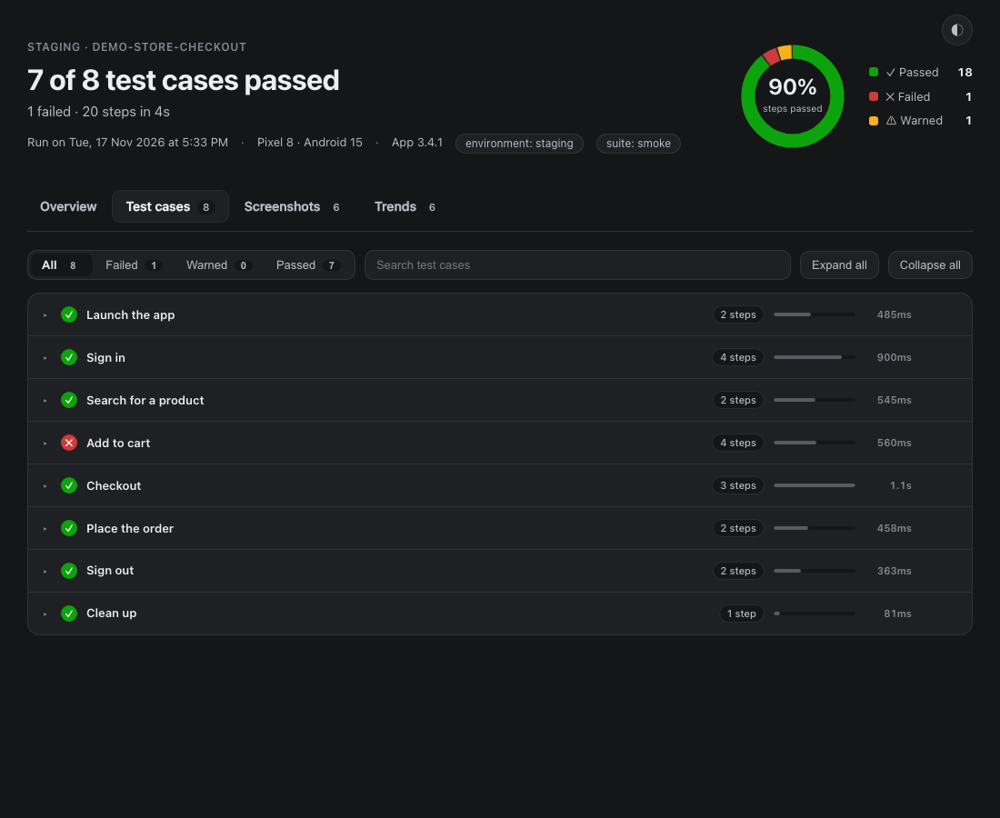

# neuron-reporter

A self-contained HTML test report for UI automation. You record your test as named **steps** grouped into **test cases**. neuron-reporter writes one HTML file containing screenshots, failure triage and run history trends.

- **One file, zero dependencies.** CSS, charts and scripts are all inline. Open it from disk, attach it to CI, or email it.
- **Works with any runner.** It has adapters for WebdriverIO / Appium, Playwright and Maestro, and a CLI for anything that can write JSON.
- **Built for QA work.** The report shows pass rate, step pass rate, execution time, the slowest steps, and failures sorted into *defects*, *needs triage* and *environment issues*.
- **Run history.** Each run is appended to a small JSON file. The Trends tab draws pass rate and execution time over time and ranks the causes that keep coming back.
- **Light and dark themes**, readable at phone width, and printable.


| Test cases | Trends |
|---|---|
|  |  |

Try it without any app or device:

```bash
npm run example        # writes examples/sample-report.html
```

---

## Install

```bash
npm install --save-dev github:ashifReza/neuron-reporter
```

You need Node 18 or newer.

## Quick start

```js
const { StepReporter } = require('neuron-reporter');

const report = new StepReporter('checkout');

await report.group('Add to cart', async () => {
  await report.step('Open the product', () => productCard.click());
  await report.step('Tap Add to cart', () => addButton.click());
  await report.softStep('Cart badge shows 1', async () => {
    const badge = await cartBadge.getText();
    report.attachDetail(`Expected: "1"\nActual: "${badge}"`);
    if (badge !== '1') throw new Error(`Expected "1" but screen shows "${badge}"`);
  });
  await report.optionalStep('Dismiss the promo sheet (if shown)', () => closePromoIfShown());
});

report.writeReport('reports/checkout.html');
report.assertNoFailures(); // fail the test if any softStep failed
```

### Step kinds

| Method | Use it for | When it fails |
|---|---|---|
| `step(name, fn)` | Actions the test cannot continue without | Recorded as **FAILED** and the error is rethrown |
| `softStep(name, fn)` | Checks and assertions | Recorded as **FAILED** and the run carries on (resolves to `false`) |
| `optionalStep(name, fn)` | Things that may legitimately not happen, such as a popup | `fn` resolving to a falsy value is recorded as **WARNED** |
| `group(name, fn)` | A test case: a collapsible block of steps | **FAILED** if anything inside failed |

Steps can also record extra evidence:

| Method | What it does |
|---|---|
| `attachScreenshot(caption)` | Attaches a checkpoint image to the most recent step or group |
| `attachDetail(text)` | Shows what a check compared, so a passing check is visible too |

A step that fails captures a screenshot automatically when a `screenshot` function is configured.

## WebdriverIO / Appium

```js
const { StepReporter, runInfo } = require('neuron-reporter');
const wdio = require('neuron-reporter/adapters/webdriverio');

let report;
beforeEach(function () {
  report = new StepReporter(this.currentTest.title, {
    screenshot: wdio.screenshot(),        // uses the global browser/driver
    runInfo: () => ({
      Environment: process.env.TEST_ENV,
      ...wdio.sessionInfo(),              // platform, device, browser, app
      ...runInfo.git(),
      ...runInfo.ci(),
    }),
  });
});

afterEach(() => report.writeReport(`reports/${report.name}.html`));
```

For Android you can also add the device model and the installed app version:
`...runInfo.android({ udid: process.env.UDID, appPackage: 'com.example.app' })`.

## Playwright

```js
const { test } = require('@playwright/test');
const { StepReporter } = require('neuron-reporter');
const pw = require('neuron-reporter/adapters/playwright');

test('checkout', async ({ page, browserName }) => {
  const report = new StepReporter('checkout', {
    screenshot: pw.screenshot(page),
    runInfo: { Browser: browserName },
  });
  await report.step('Open the store', () => page.goto('https://example.com'));
  // ...
  report.writeReport('reports/checkout.html');
  report.assertNoFailures();
});
```

## Maestro

Give each `runFlow` block a `label:` in the flow file, and each block becomes a test case:

```bash
npx neuron-reporter maestro login_flow -o reports/login.html          # newest run of a flow under ~/.maestro/tests
npx neuron-reporter maestro path/to/run/login_flow -o reports/login.html
```

## Options

```js
new StepReporter(name, {
  screenshot,          // async () => base64 string | Buffer | data URI | null
  screenshotOnFailure, // default true
  runInfo,             // { label: value } or () => ({ ... }) — the Run details card
  highlights,          // ['Pixel 8 · Android 15', 'App 3.4.1'] — short facts under the headline
  labels,              // { environment: 'staging' } — pills in the header, saved with history
  history,             // true (default) | false | { dir, maxRuns }
  rules,               // extra failure-classification rules, see below
  console,             // default true — live ✔ / ✘ lines while the test runs
});
```

`writeReport(path)` returns `{ path, counts, historyFile }`. `toJSON()` returns the raw tree.

## Run history

By default each `writeReport()` appends the run to `<report folder>/history/<name>.json`. It keeps the last 50 runs, and writing the same run again (for example from an `afterEach`) replaces its record. When there are two or more runs, the **Trends** tab shows:

- **Pass rate per run** and **Execution time per run**, as line charts. Hover a point for details; hollow points are runs with failures.
- **Common issues:** failure causes ranked by how often they occur, with an example and a hint.
- **Steps that failed:** which steps fail most often across runs, which shows flaky steps.

Add the history folder to `.gitignore`. Alternatively, cache it in CI so trends survive between pipeline runs.

## Failure classification

Every failed step is tagged with a cause, and each cause rolls up into a triage bucket:

| Bucket | Default causes |
|---|---|
| **Potential defects** | Value mismatch (`Expected … but …`, assertion errors) |
| **Needs triage** | Element not found, expected state never appeared, other |
| **Environment** | Network drop / timeout, rate limited (429), blocked (403), auth failed (401), server error (5xx) |

You can add your own rules. They are checked before the defaults:

```js
new StepReporter('login', {
  rules: [
    { key: 'otp', type: 'environment', label: 'OTP not delivered', hint: 'Check the SMS gateway.', test: /otp/i },
    { key: 'price-format', type: 'defect', label: 'Price formatting', test: (msg) => msg.includes('$') },
  ],
});
```

## CLI and the tree format

```bash
npx neuron-reporter render run.json -o report.html [--title NAME] [--history DIR | --no-history]
```

The CLI exits with code `1` when any test case failed, so CI can use it. `run.json` is either what `report.toJSON()` returns, or a bare array of nodes:

```json
{
  "name": "checkout",
  "startedAt": "2026-11-17T10:00:00Z",
  "tree": [
    {
      "description": "Add to cart",
      "status": "FAILED",
      "duration": 1830,
      "isGroup": true,
      "children": [
        { "description": "Tap Add to cart", "status": "COMPLETED", "duration": 410, "isGroup": false, "children": [] },
        { "description": "Cart total matches", "status": "FAILED", "duration": 52, "isGroup": false, "children": [],
          "error": "Expected \"$24.00\" but screen shows \"$24\"",
          "screenshot": { "dataUri": "data:image/png;base64,…", "caption": "Failure — Cart total matches" } }
      ]
    }
  ]
}
```

`status` is one of `COMPLETED`, `FAILED`, `WARNED`, `PENDING` or `SKIPPED`, and `duration` is in milliseconds.

## Development

```bash
npm test          # node:test, no dependencies
npm run example   # regenerate examples/sample-report.html
```

## License

MIT. See [LICENSE](LICENSE).
