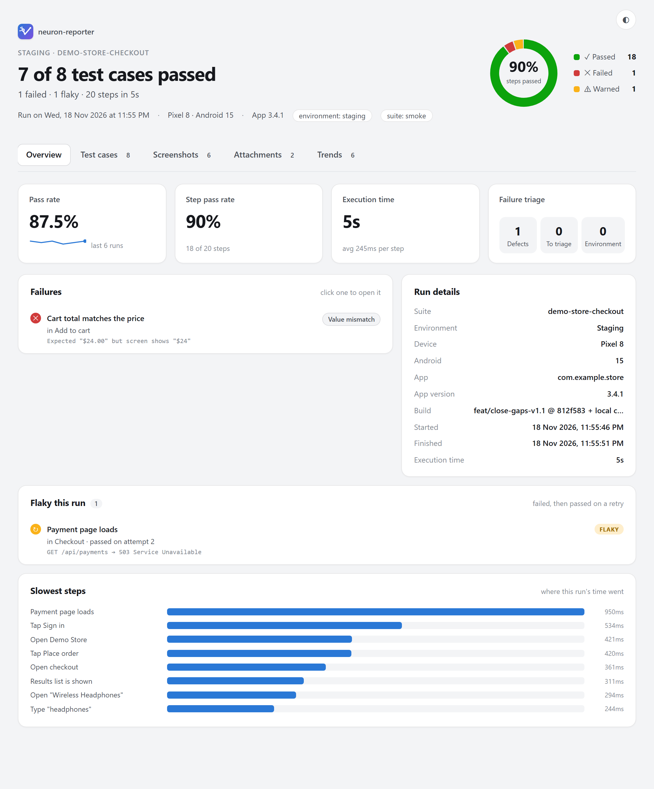
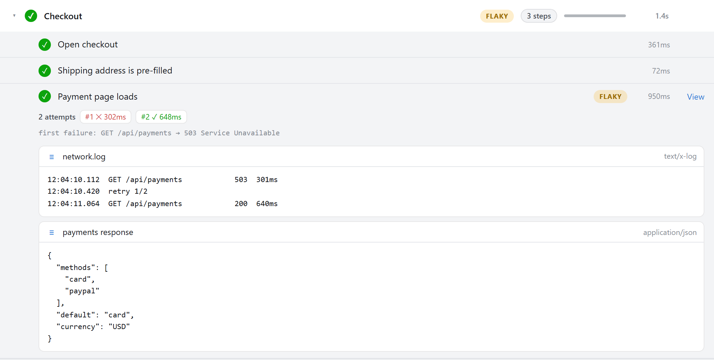
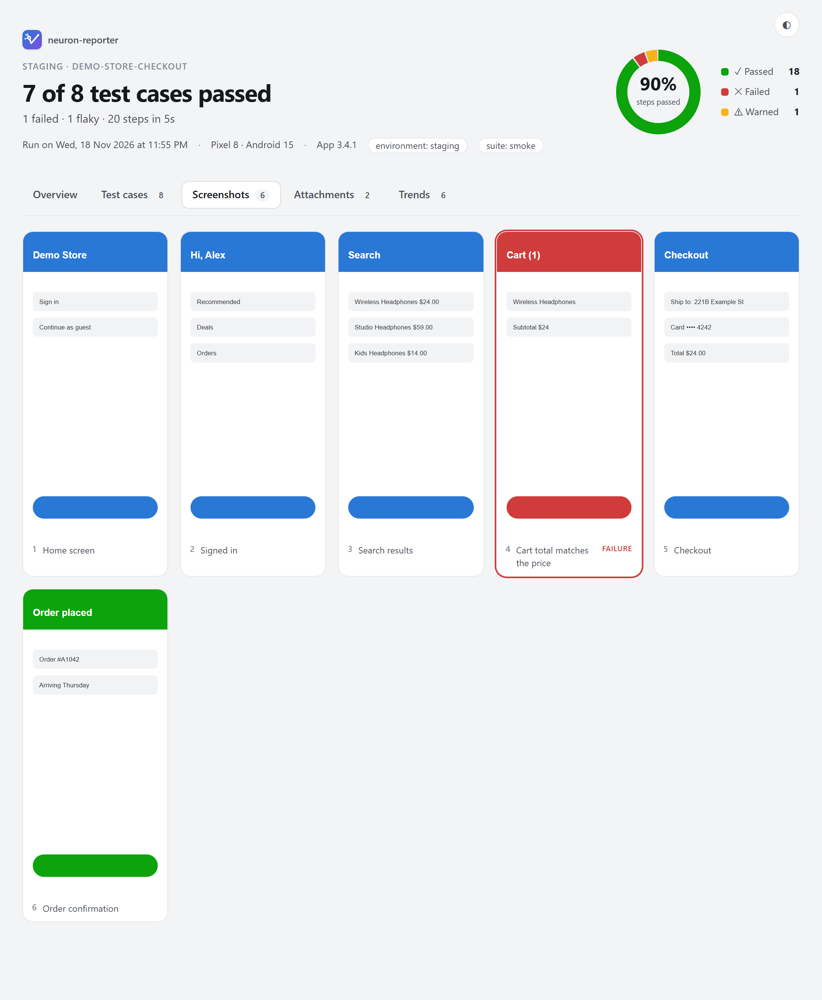
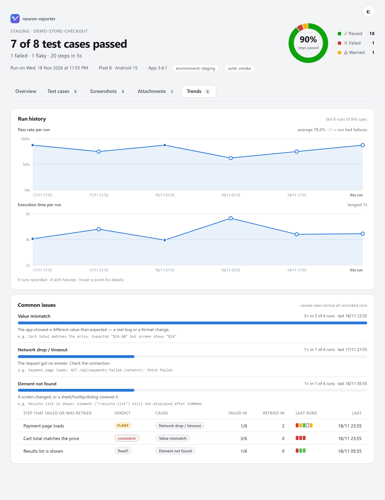
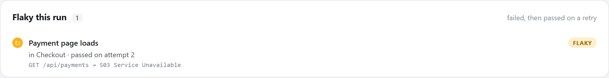
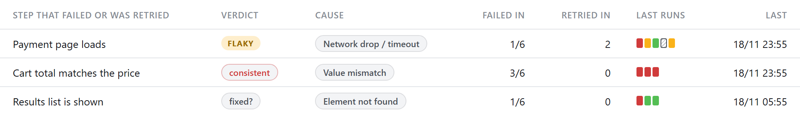
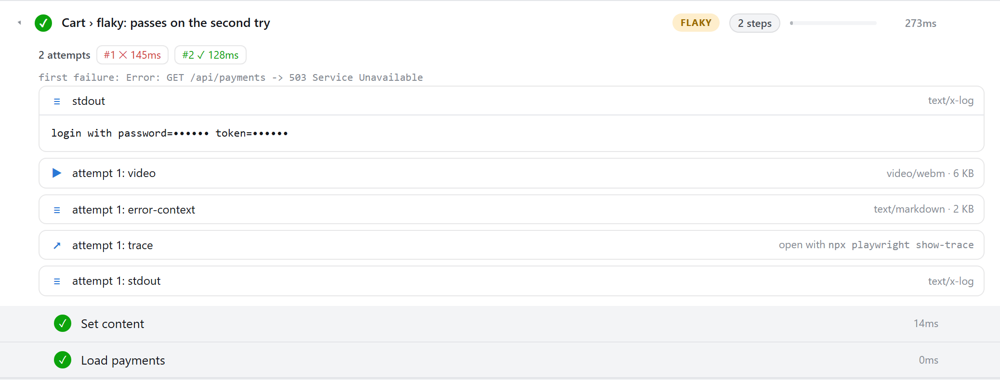

<p align="center"></p>

<h1 align="center">neuron-reporter</h1>

A self-contained HTML test report for UI automation. You record your test as named **steps** grouped into **test cases**. neuron-reporter writes one HTML file containing screenshots, failure triage and run history trends.

- **One file, zero dependencies.** CSS, charts and scripts are all inline. Open it from disk, attach it to CI, or email it.
- **Works with any runner, in any language.** A one-line [Playwright Test reporter](#playwright-test-reporter-one-line-setup), adapters for WebdriverIO / Appium and Maestro, a [JUnit XML importer](#junit-xml-any-language) for pytest, TestNG, JUnit, Maven, Gradle, Go, .NET, Jest and Cypress, and a CLI for anything that can write [JSON](schema/run.schema.json).
- **Built for QA work.** The report shows pass rate, step pass rate, execution time, the slowest steps, and failures sorted into *defects*, *needs triage* and *environment issues*.
- **Retries and flaky detection.** Steps or tests that fail and then pass on a retry are marked **flaky**, with every attempt kept. Across runs, the Trends tab tells *flaky* steps (pass/fail flip-flops) from *consistent* failures.
- **Evidence beyond screenshots.** Attach logs, text, JSON, videos, Playwright traces, files and links to any step.
- **Run history.** Each run is appended to a small JSON file. The Trends tab draws pass rate and execution time over time and ranks the causes that keep coming back.
- **CI-ready.** A [GitHub Action](#github-action) that keeps history between workflow runs, plus exit codes for any CI. [Shards and parallel jobs](#shards-and-parallel-jobs) merge into one report.
- **Safe to share.** [Secret redaction](#secret-redaction) is on by default. Tokens, passwords, keys and secret env values are hidden in the report and the history.
- **Light and dark themes**, readable at phone width, and printable.

## Contents

- [Walkthrough: from zero to a report in five steps](#walkthrough)
- [What's new in 1.1 and 1.2](#whats-new-in-11-and-12)
- Reference: [StepReporter](#recording-steps-with-stepreporter) · [WebdriverIO / Appium](#webdriverio--appium) · [Playwright](#playwright-test-reporter-one-line-setup) · [Maestro](#maestro) · [JUnit XML](#junit-xml-any-language) · [GitHub Action](#github-action) · [Shards](#shards-and-parallel-jobs) · [Redaction](#secret-redaction) · [Step identity](#stable-step-identity) · [Options](#options) · [History](#run-history) · [Failure classification](#failure-classification) · [CLI and JSON format](#cli-and-the-tree-format)

---

## Walkthrough

Want to look before installing anything? Clone the repo and run `npm run example`. It writes [`examples/sample-report.html`](examples/sample-report.html) from a made-up "Demo Store" run, which is what all the screenshots below show.

### 1. Install

```bash
npm install --save-dev neuron-reporter
```

You need Node 18 or newer, and TypeScript types are included. Until the package is on npm, install it from GitHub with `npm install --save-dev github:ashifReza/neuron-reporter`.

### 2. Connect it to your tests

Pick the row that matches how you test. Each one ends with the same kind of HTML report.

| You use | Do this | Details |
|---|---|---|
| **Playwright Test** | Add one line to `playwright.config` | [Playwright reporter](#playwright-test-reporter-one-line-setup) |
| **WebdriverIO / Appium** (or any JS code) | Wrap actions in `report.step(...)` | [StepReporter](#recording-steps-with-stepreporter) |
| **Maestro** | Run `npx neuron-reporter maestro <flow>` after the flow | [Maestro](#maestro) |
| **pytest, JUnit/TestNG, Gradle, Go, .NET, Jest, Cypress…** | Have your runner write JUnit XML, then run `npx neuron-reporter junit <file or folder>` | [JUnit XML](#junit-xml-any-language) |
| **Anything else** | Write JSON that follows [the schema](schema/run.schema.json), then run `npx neuron-reporter render run.json` | [CLI](#cli-and-the-tree-format) |

The two most common setups look like this:

```js
// Playwright: playwright.config.js. No changes to your tests.
module.exports = {
  retries: 2,
  reporter: [['list'], ['neuron-reporter/playwright-reporter', { outputFile: 'neuron-report/index.html' }]],
  use: { screenshot: 'only-on-failure', video: 'retain-on-failure', trace: 'retain-on-failure' },
};
```

```js
// Any JS test (WebdriverIO, Appium, plain Node): name your steps.
const { StepReporter } = require('neuron-reporter');
const wdio = require('neuron-reporter/adapters/webdriverio');

const report = new StepReporter('checkout', { screenshot: wdio.screenshot(), retries: 1 });

await report.group('Add to cart', async () => {
  await report.step('Tap Add to cart', () => $('~add').click());
  await report.softStep('Cart badge shows 1', async () => {
    const badge = await $('~badge').getText();
    if (badge !== '1') throw new Error(`Expected "1" but screen shows "${badge}"`);
  });
});

report.writeReport('reports/checkout.html');
report.assertNoFailures(); // the test still fails if a softStep failed
```

### 3. Run your tests and open the report

Run your tests as usual. The console prints one line and the report's path:

```text
📊 7/8 test cases passed, 1 failed, 0 warned, 1 flaky — 5s → reports/checkout.html
```

Open that file in any browser. It's a single file, so you can also attach it to a CI run, a ticket or an email. Next to it there's a small `history/` folder, which feeds the Trends tab.

### 4. Read the report

**Overview: is this run OK, and if not, why?** The headline gives pass/fail counts. The four tiles show pass rate (with a trend line), step pass rate, run time, and a **triage** count that sorts failures into *defects*, *needs triage* and *environment*. Below them, every failure links to its test case. **Flaky this run** lists steps that failed and then passed on a retry, and **Slowest steps** shows where the time went.



**Test cases: what exactly happened.** Every test case expands into its steps, with timings, errors and what each check compared. Filter by *Failed / Warned / Passed / Flaky*, or search. A retried step shows its attempts (`#1 ✕ 303ms`, `#2 ✓ 650ms`) and the first failure's message. Logs, JSON, videos and traces attached to the step open in place.



**Screenshots and Attachments: the evidence in one place.** The Screenshots tab shows every checkpoint image in order, with the failure screenshot outlined in red. The Attachments tab lists every log, video, trace and file, grouped by step.



**Trends: is it getting better or worse?** Pass rate and run time over recent runs, the causes that keep coming back, and a verdict for every step that failed or needed a retry:

- **flaky:** it fails sometimes, so stabilise the test or the environment.
- **consistent:** it fails every run, so it's probably a real bug.
- **fixed?:** it failed before but has passed since.

The coloured squares are that step's recent runs: red failed, amber passed on a retry, green passed, outlined didn't run.



### 5. Run it in CI

The report becomes more useful the more history it has, so keep the `history/` folder between CI runs. On GitHub Actions, the bundled action does that for you, uploads the report, and adds a summary to the job:

```yaml
- run: pytest --junitxml=results/junit.xml   # or any runner that writes JUnit XML
- uses: ashifReza/neuron-reporter@v1
  if: always()
  with:
    input: results          # file(s) or folder(s)
    title: api-tests        # keep it stable so trends line up
```

With the Playwright reporter, add `jsonFile: 'neuron-report/run.json'` to its options, then use `command: render` and `input: neuron-report/run.json`. On other CI systems, run the CLI and cache `<report folder>/history`. The exit code is `0` when everything passed and `1` when a test failed, so a pipeline can gate on it. Splitting a suite across several machines? Each shard writes JSON, and `neuron-reporter merge` turns them into [one report](#shards-and-parallel-jobs).

That's the whole loop. The sections below cover every option.

---

## What's new in 1.1 and 1.2

**Retries and flaky detection.** Retry a step with `report.step(name, fn, { retries: 2 })`, or let Playwright retry tests. A test or step that passes on a retry is marked **flaky**, and every attempt is kept. Each run lists its flaky steps:



Across runs, each step gets a verdict that separates intermittent failures from real regressions. It also knows when a step didn't run at all, so a step skipped after an earlier failure isn't mistaken for a pass:



**Videos, traces, logs and files on every step.** Use `attach()`, `attachLog()`, `attachVideo()`, `attachFile()` and `attachLink()`, or get them automatically from the Playwright reporter. Here is a real Playwright test that failed once and passed on retry: the first attempt's video, trace and error context are kept, and the test's stdout is shown with its secrets hidden.



**Every language, through JUnit XML.** `neuron-reporter junit` reads what pytest, Maven/Gradle (JUnit, TestNG), Go, .NET, Jest, Cypress and Robot Framework already write. That includes Surefire's reruns, so flaky detection works for Java too. [More →](#junit-xml-any-language)

**One report from many machines.** `neuron-reporter merge` combines shards or parallel jobs into one report and one history record. Playwright's `--shard` is handled automatically. History writes are now safe when several processes write at once. [More →](#shards-and-parallel-jobs)

**Secrets stay out of the report.** Bearer tokens, passwords, API keys, JWTs, credentials in URLs and secret-looking environment variables are replaced with `••••••` in the report, the history and shard files. It's on by default. [More →](#secret-redaction)

**Stable history.** Steps keep their history when you rename them if you give them an `id`. [More →](#stable-step-identity)

**Also new:** a [GitHub Action](#github-action), TypeScript types, ESM support, a [JSON Schema](schema/run.schema.json) for the input format, and failure triage that understands Playwright/Jest assertion output and test timeouts. See the [CHANGELOG](CHANGELOG.md) for the full list.

---

## Recording steps with StepReporter

Use this in WebdriverIO, Appium, Playwright (without the reporter) or any JS test. Name each action and check, and group them into test cases:

```js
const { StepReporter } = require('neuron-reporter');

const report = new StepReporter('checkout');

await report.group('Add to cart', async () => {
  await report.step('Open the product', () => productCard.click());
  await report.step('Tap Add to cart', () => addButton.click());
  await report.softStep('Cart badge shows 1', async () => {
    const badge = await cartBadge.getText();
    report.attachDetail(`Expected: "1"\nActual: "${badge}"`);
    if (badge !== '1') throw new Error(`Expected "1" but screen shows "${badge}"`);
  });
  await report.optionalStep('Dismiss the promo sheet (if shown)', () => closePromoIfShown());
});

report.writeReport('reports/checkout.html');
report.assertNoFailures(); // fail the test if any softStep failed
```

### Step kinds

| Method | Use it for | When it fails |
|---|---|---|
| `step(name, fn)` | Actions the test cannot continue without | Recorded as **FAILED** and the error is rethrown |
| `softStep(name, fn)` | Checks and assertions | Recorded as **FAILED** and the run carries on (resolves to `false`) |
| `optionalStep(name, fn)` | Things that may legitimately not happen, such as a popup | `fn` resolving to a falsy value is recorded as **WARNED** |
| `group(name, fn)` | A test case: a collapsible block of steps | **FAILED** if anything inside failed |

Steps can also record extra evidence:

| Method | What it does |
|---|---|
| `attachScreenshot(caption)` | Attaches a checkpoint image to the most recent step or group |
| `attachDetail(text)` | Shows what a check compared, so a passing check is visible too |
| `attach(name, content, { contentType })` | Attaches text, a `Buffer` or an object (shown as JSON) |
| `attachLog(name, lines)` | Attaches log lines in a collapsible monospace block |
| `attachVideo(name, file)` / `attachFile(name, file)` | Attaches a video, trace, HAR or any file. Files up to 8 MB are embedded, so the report stays one file. Bigger ones are linked relative to the report (`{ embed, maxEmbedBytes }`) |
| `attachLink(name, url)` | Attaches a link, such as a CI job or a ticket |

A step that fails captures a screenshot automatically when a `screenshot` function is configured. Every attachment also appears in the **Attachments** tab.

### Retries and flaky steps

```js
// Retry this step up to 2 more times. fn receives the attempt number (0-based).
await report.step('Payment page loads', ({ attempt }) => paymentPage.waitForLoad(), { retries: 2 });

// Or for every step() and softStep() (never optionalStep):
new StepReporter('checkout', { retries: 1, retryDelay: 500 });
```

A step that fails and then passes is **COMPLETED but flaky**. It gets a *flaky* badge, a list of its attempts and the first failure's message. The Overview tab has a *Flaky this run* card, and the Test cases tab has a *Flaky* filter. A step that fails every attempt is FAILED, with all its attempts listed. `report.flakySteps()` returns this run's flaky steps.

## WebdriverIO / Appium

```js
const { StepReporter, runInfo } = require('neuron-reporter');
const wdio = require('neuron-reporter/adapters/webdriverio');

let report;
beforeEach(function () {
  report = new StepReporter(this.currentTest.title, {
    screenshot: wdio.screenshot(),        // uses the global browser/driver
    runInfo: () => ({
      Environment: process.env.TEST_ENV,
      ...wdio.sessionInfo(),              // platform, device, browser, app
      ...runInfo.git(),
      ...runInfo.ci(),
    }),
  });
});

afterEach(() => report.writeReport(`reports/${report.name}.html`));
```

For Android you can also add the device model and the installed app version:
`...runInfo.android({ udid: process.env.UDID, appPackage: 'com.example.app' })`.

## Playwright Test reporter (one-line setup)

You don't need to change any test code. Add the reporter to `playwright.config`:

```js
// playwright.config.js
module.exports = {
  retries: 2,
  reporter: [['list'], ['neuron-reporter/playwright-reporter', { outputFile: 'neuron-report/index.html' }]],
  use: { screenshot: 'only-on-failure', video: 'retain-on-failure', trace: 'retain-on-failure' },
};
```

Each test becomes a test case. Its `test.step()` blocks, `expect()` calls and page actions become steps. Playwright's retries become attempts, and a test that passes on a retry is marked flaky. The failure screenshot, the video and trace of every attempt, and stdout/stderr are attached. Browser and page setup inside fixtures and hooks is hidden unless it fails. A `test.fail()` test that fails as expected counts as passed, and its failed steps show as warnings.

Options:

- `outputFile`: where the HTML report goes.
- `title`: the report and history name.
- `history`: `false` to turn history off, or `{ dir, maxRuns }`.
- `stepCategories`: which step kinds to show. Default `['test.step', 'expect', 'pw:api']`.
- `embed` and `maxEmbedBytes`: whether video/trace files are embedded or linked.
- `jsonFile`: also write the run as JSON, for the GitHub Action or `merge`.
- `redact`: secret redaction, on by default.
- `rules`: extra failure-classification rules.
- `labels`: pills shown in the report header.

## Playwright (manual steps)

```js
const { test } = require('@playwright/test');
const { StepReporter } = require('neuron-reporter');
const pw = require('neuron-reporter/adapters/playwright');

test('checkout', async ({ page, browserName }) => {
  const report = new StepReporter('checkout', {
    screenshot: pw.screenshot(page),
    runInfo: { Browser: browserName },
  });
  await report.step('Open the store', () => page.goto('https://example.com'));
  // ...
  report.writeReport('reports/checkout.html');
  report.assertNoFailures();
});
```

## Maestro

Give each `runFlow` block a `label:` in the flow file, and each block becomes a test case:

```bash
npx neuron-reporter maestro login_flow -o reports/login.html          # newest run of a flow under ~/.maestro/tests
npx neuron-reporter maestro path/to/run/login_flow -o reports/login.html
```

## JUnit XML (any language)

Almost every test runner can write JUnit XML. Point the CLI at the files or folders:

```bash
npx neuron-reporter junit target/surefire-reports -o report.html            # Maven / JUnit / TestNG
npx neuron-reporter junit build/test-results/test -o report.html --group class  # Gradle
npx neuron-reporter junit results.xml -o report.html --title api-tests       # pytest --junitxml=results.xml
```

| Runner | How to get JUnit XML |
|---|---|
| pytest | `pytest --junitxml=results.xml` |
| Maven Surefire / Failsafe | written to `target/surefire-reports` by default. Add `-Dsurefire.rerunFailingTestsCount=2` for flaky detection |
| Gradle | written to `build/test-results/test` by default |
| TestNG | `testng-results` → use the `junitreports` folder |
| Go | `gotestsum --junitfile results.xml` |
| .NET | `dotnet test --logger "junit;LogFilePath=results.xml"` (JunitXml.TestLogger) |
| Jest | `jest-junit` |
| Cypress / Playwright / WebdriverIO | their `junit` reporters |
| Robot Framework | `robot --xunit results.xml` |

The importer maps:

- `<failure>` and `<error>` to FAILED, and `<skipped>` to SKIPPED.
- Surefire's `<flakyFailure>` and `<rerunFailure>` to attempts. A test that passes after a rerun is flaky.
- A test listed twice to a retry.
- `<system-out>` and `<system-err>` to log attachments.
- `[[ATTACHMENT|path]]` lines and `attachment` properties to file attachments.

`--group suite|class` turns suites or classes into collapsible test cases.

Prefer to write the report data yourself, from Python, Java or C#? Write JSON that follows [`schema/run.schema.json`](schema/run.schema.json) and run `neuron-reporter render`.

## GitHub Action

```yaml
- run: pytest --junitxml=results/junit.xml
- uses: ashifReza/neuron-reporter@v1
  if: always()
  with:
    input: results                 # files or folders, space-separated
    title: api-tests               # keep it stable so trends line up
    fail-on-test-failure: true
```

The action restores and saves run history with the Actions cache, so the Trends tab keeps growing between workflow runs. It uploads the report as an artifact and writes a job summary. Its inputs are `command` (`junit` | `render` | `maestro`), `input`, `output`, `title`, `group`, `history`, `fail-on-flaky`, `fail-on-test-failure`, `upload-artifact` and `artifact-name`.

To pass extra CLI flags, use `extra-args`, for example `extra-args: --redact ORDER-[0-9]+`.

On other CI systems, run the CLI and cache `<report folder>/history`. The CLI exits with `0` when everything passed and `1` when a test case failed (or was flaky, with `--fail-on-flaky`). It exits with `2` when the CLI itself failed.

## Shards and parallel jobs

When a suite is split across CI jobs, each job writes its run as JSON instead of its own history entry. One final step then merges them, so you get one report and one history record for the whole suite.

**Playwright:** run with `--shard=1/4` and the reporter does this by itself. Each shard writes `neuron-report/shards/shard-1-of-4.json` and skips history. Collect those files from every job, then merge:

```bash
npx neuron-reporter merge all-shards/ -o neuron-report/index.html
```

```yaml
# GitHub Actions: test jobs upload neuron-report/shards/*.json as artifacts, then:
merge-report:
  needs: test
  if: always()
  runs-on: ubuntu-latest
  steps:
    - uses: actions/download-artifact@v4
      with: { pattern: shard-*, path: all-shards, merge-multiple: true }
    - uses: ashifReza/neuron-reporter@v1
      with: { command: merge, input: all-shards, title: e2e }
```

**StepReporter:** call `report.writeJSON('shards/<job>.json')` in each job instead of `writeReport()`, then run `neuron-reporter merge shards/`.

**JUnit:** pass every job's XML to one `neuron-reporter junit` call.

The merged run starts at the earliest shard's start and lasts until the latest shard's end, which is wall-clock time. Its test cases are listed in shard-file order. Attachment files that are linked rather than embedded must be uploaded along with the JSON, keeping the same relative paths.

History is also safe when several processes write it at once, for example parallel workers on one machine or one shared folder. Writers take turns through a lock, and each write replaces the file atomically. A lock left behind by a crashed writer is taken over after 30 seconds. Runs that finish out of order are sorted by start time.

## Secret redaction

Reports and history files get shared, so text is redacted before it's written. This covers step names, errors, details, logs, text/JSON attachments, retry errors, run details and labels. It's on by default and hides:

- `Authorization: Bearer …` and `Basic …` credentials, JWTs, and `user:password@` in URLs
- `password=…`, `"token": "…"`, `api_key: …`, `client_secret=…` and similar key/value forms, including in JSON
- AWS access keys, GitHub, GitLab, Slack and Stripe tokens, `sk-…` API keys, and private key blocks
- the values of environment variables whose names look secret (`*PASSWORD*`, `*TOKEN*`, `*SECRET*`, `*API_KEY*`, `*OTP*`, `*PIN*`, …) that are 6+ characters long

```js
new StepReporter('login', {
  redact: { values: [testUser.pin], patterns: [/ORDER-\d+/] }, // add your own
  // redact: false,                                            // or turn it off
});
```

The CLI has `--redact REGEX` (repeatable) and `--no-redact`. The Playwright reporter takes the same `redact` option. **Screenshots and videos can't be redacted**, so keep real secrets off screen in tests.

## Stable step identity

Run history tracks each step by its path, *test case › group › step*. Repeated names get ` #2`, ` #3`. Each run also records which steps actually ran, so the Trends tab can tell "did not run" (an outlined square) from "passed". A step skipped because an earlier one aborted the test is no longer counted as a pass, so it can't look flaky or fixed.

Renaming a step starts a new history unless you give it an `id`:

```js
await report.step('Pay with saved card', () => pay(), { id: 'checkout.pay' });
await report.group('Checkout', async () => { /* … */ }, { id: 'checkout' });
```

Steps inside a test case with an `id` are keyed under that id, so they keep their history too.

- **Playwright:** the reporter uses Playwright's test id. That id stays the same between runs, but it changes when you rename the test or move it to another file. To keep history across a rename, add an `id` annotation:
  ```js
  test('pays with a saved card', { annotation: { type: 'id', description: 'checkout.pay' } }, async ({ page }) => { /* … */ });
  ```
- **JUnit:** the importer uses `classname::name`.
- **JSON input:** set `"id"` on a node.

## Options

```js
new StepReporter(name, {
  screenshot,          // async () => base64 string | Buffer | data URI | null
  screenshotOnFailure, // default true
  runInfo,             // { label: value } or () => ({ ... }) — the Run details card
  highlights,          // ['Pixel 8 · Android 15', 'App 3.4.1'] — short facts under the headline
  labels,              // { environment: 'staging' } — pills in the header, saved with history
  history,             // true (default) | false | { dir, maxRuns }
  rules,               // extra failure-classification rules, see below
  console,             // default true — live ✔ / ✘ lines while the test runs
  retries,             // default 0 — retries for every step() / softStep()
  retryDelay,          // default 0 — ms between attempts
  redact,              // default on — false, or { values, patterns, env, replacement }
});
```

`writeReport(path)` returns `{ path, counts, flaky, historyFile }`. `writeJSON(path)` writes the redacted run for `merge`. `toJSON()` returns the raw tree.

## Run history

By default each `writeReport()` appends the run to `<report folder>/history/<name>.json`. It keeps the last 50 runs, and writing the same run again (for example from an `afterEach`) replaces its record. When there are two or more runs, the **Trends** tab shows:

- **Pass rate per run** and **Execution time per run**, as line charts. Hover a point for details; hollow points are runs with failures.
- **Common issues:** failure causes ranked by how often they occur, with an example and a hint.
- **Steps that failed or were retried**, each with a verdict and a strip of its recent outcomes:
  - **flaky:** it passed on a retry at least once, or switched between pass and fail two or more times.
  - **consistent:** it failed in every run since it first failed, which is a real regression.
  - **fixed?:** it failed, then kept passing.

Add the history folder to `.gitignore`. Alternatively, cache it in CI so trends survive between pipeline runs.

## Failure classification

Every failed step is tagged with a cause, and each cause rolls up into a triage bucket:

| Bucket | Default causes |
|---|---|
| **Potential defects** | Value mismatch (`Expected … but …`, assertion errors) |
| **Needs triage** | Element not found, expected state never appeared, other |
| **Environment** | Network drop / timeout, rate limited (429), blocked (403), auth failed (401), server error (5xx) |

You can add your own rules. They are checked before the defaults:

```js
new StepReporter('login', {
  rules: [
    { key: 'otp', type: 'environment', label: 'OTP not delivered', hint: 'Check the SMS gateway.', test: /otp/i },
    { key: 'price-format', type: 'defect', label: 'Price formatting', test: (msg) => msg.includes('$') },
  ],
});
```

## CLI and the tree format

```bash
npx neuron-reporter render run.json -o report.html [--title NAME] [--history DIR | --no-history] [--fail-on-flaky] [--no-embed] [--redact REGEX] [--no-redact]
npx neuron-reporter merge shards/ -o report.html   # several run files → one report
```

The CLI exits with code `1` when any test case failed, so CI can use it. The full format is in [`schema/run.schema.json`](schema/run.schema.json). Besides the fields below, any node can carry `attempts` (`[{ status, duration, error }]`, the last one is final), `flaky`, and `attachments` (`[{ name, contentType, body | dataUri | path }]`, with paths relative to the JSON file). `run.json` is either what `report.toJSON()` returns, or a bare array of nodes:

```json
{
  "name": "checkout",
  "startedAt": "2026-11-17T10:00:00Z",
  "tree": [
    {
      "description": "Add to cart",
      "status": "FAILED",
      "duration": 1830,
      "isGroup": true,
      "children": [
        { "description": "Tap Add to cart", "status": "COMPLETED", "duration": 410, "isGroup": false, "children": [] },
        { "description": "Cart total matches", "status": "FAILED", "duration": 52, "isGroup": false, "children": [],
          "error": "Expected \"$24.00\" but screen shows \"$24\"",
          "screenshot": { "dataUri": "data:image/png;base64,…", "caption": "Failure — Cart total matches" } }
      ]
    }
  ]
}
```

`status` is one of `COMPLETED`, `FAILED`, `WARNED`, `PENDING` or `SKIPPED`, and `duration` is in milliseconds.

## Development

```bash
npm test          # node:test, no dependencies
npm run example   # regenerate examples/sample-report.html
```

The README screenshots in `docs/` come from the sample report. To regenerate them, install Playwright with Chromium (it isn't a dependency), then run the script. Pass it a report written by the Playwright reporter to also capture `playwright-flaky-test.png`:

```bash
npm i --no-save playwright && npx playwright install chromium
node scripts/readme-screenshots.js [path/to/playwright-report.html]
```

## License

MIT. See [LICENSE](LICENSE).
